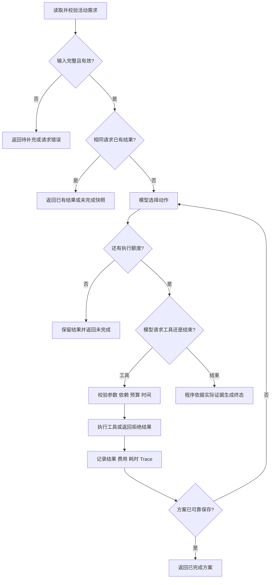

# 技术方案：模型决策与可验证执行

版本：v0.5；日期：2026-10-28；状态：单机稳定性强化已实现，实际门槛与剩余限制见 [强化报告](13-hardening-progress.md) 和 [运行手册](14-operations.md)。需求与业务定义见 [PRD](01-requirements.md) 和 [术语](../CONTEXT.md)，实际结果见 [评估报告](03-evaluation.md)。

## 1. 推荐技术与取舍

| 选择 | 本期方案 | 理由与代价 |
| --- | --- | --- |
| 语言与入口 | Python 3.14.10、CLI、JSON 输入/输出 | 发布运行时见 runtime.lock.json；SQLite 3.53.1；无需 pip |
| Agent 编排 | 原生、有限次数的单 Agent 循环 | 四类本地工具即可完成任务；循环、状态和约束能直接审查，但需要自己处理有限的参数校验与日志 |
| 模型 | 一个真实模型 Adapter + 一个离线 Mock Adapter | 两者共用动作格式；不会把 Mock 当成真实模型能力 |
| 默认 live 接入 | 用户授权网关 `http://100.73.185.103:8045/v1`，实际模型 ID `claude-opus-4-6-thinking` | 原生 Chat Completions 工具调用已实际跑通；请求和响应模型名、工具观察与 Token 用量均记录 |
| HTTP 与数据类型 | 标准库 `urllib.request`、`json`、`dataclasses`、`datetime` | 本期优先不加依赖；超时、响应截断与参数校验由小范围代码处理 |
| 状态与保存 | 标准库 `sqlite3`，唯一约束与事务 | 无独立数据库进程，适合本地原型。[Python 官方 sqlite3](https://docs.python.org/3.11/library/sqlite3.html) |
| 测试与记录 | `unittest`、JSONL Trace、实际 JSON/Markdown 结果 | 无额外评估平台，评审可直接检查实际行为 |

2026-10-28 用户授权该网关与 Opus 4.6。真实模型列表未列出最初写法 `claude-opus-4.6`，列出 `claude-opus-4-6-thinking`；后者已成功返回原生工具调用，后续请求和响应均使用此 ID，本机与示例配置已更新。首次 503 错误另包含账号池限流冷却信息，不据此断言只由别名导致。网关协议已实测，底层模型快照仍无法独立核验，见[模型接入记录](09-model-gateway.md)。

采用非流式 Chat Completions 请求与原生 function tools，以显式工具参数和一行 `decision_summary` 记录决策依据，不要求、保存内部思维过程。当前用户配置的本地网关请求不附带 DeepSeek 专用 thinking 参数；四个业务工具由程序执行与校验；额外的原生 `finish_task` 只负责结构化结束，记录在决策日志的 finish 字段，不能宣称已保存。结束状态与标准错误码由同一校验约束；它计入模型决策次数。

### 为什么暂不采用 LangGraph 或可视化平台

LangGraph 官方提供持久化、人工介入以及确定性步骤与模型动作混合编排的能力。[LangGraph overview](https://docs.langchain.com/oss/python/langgraph/overview) 这些能力有价值，但本题先限定为一个串行循环、四类本地工具和明确的终态。选择原生实现是本项目范围下的取舍，不是宣称框架过重或功能不足。P1 以后若需要较复杂的跨进程暂停/恢复，再评估其检查点能力；使用框架也仍需实现业务幂等。[Persistence](https://docs.langchain.com/oss/python/langgraph/persistence)

Dify、Flowise、n8n 适合有可视化或多系统连接需求的场景；本题本地工具已足够。Jasper、Copy.ai 的内容上下文与分步交付思路可以借鉴，但不引入它们的平台依赖。具体依据见 [同类调研](00-competitive-research.md)。

## 2. 主要 Module 与 Interface

文件划分是预期结构，可在实现时合并小文件，不创建通用插件系统、Repository 抽象或多供应商工厂。

| Module | 对外 Interface | 负责的行为 |
| --- | --- | --- |
| CLI | 读取输入、配置并调用 `run(brief, model, store, clock)` | 格式错误、运行模式、退出码、导出结果 |
| Agent | `run(...) -> RunResult` | 消息历史、有限循环、实际动作分派、约束检查、确定终态 |
| Model | `decide(messages, tools) -> ModelDecision` | live 与 mock 两个真实变化点；只输出动作/结束建议，不执行工具 |
| Tools | `search_materials` / `estimate_cost` / `generate_script` / `save_plan` | 资料事实、报价、生成结果和保存事实 |
| State | 请求、操作结果、费用与保存记录的读写 | 事务、唯一性、步骤复用、费用和业务时间累计 |

两个值得保留的 Seam：模型决策可换 live/mock；时间起点可换真实启动时间/固定测试时间。其余依赖先使用普通函数和显式参数，不为了可能的未来供应商增加 Interface。

## 3. 调用与控制流程



运行前与每次模型调用/工具执行前都检查剩余额度和真实派发期限，图中的额度节点仅用于说明。模型调用总数、工具动作尝试总数分别计数；未知工具、非法参数、失败和拒绝动作都占用工具尝试额度。

程序可以确定地拒绝越界动作，但不会在拒绝后自动替模型选择 economy。拒绝结果或工具失败必须写入消息历史，由下一次真实模型调用选择下一步。素材来源、硬约束、费用、状态以及 `completed` 判断均不能由模型文本覆盖。

模型自然语言返回若表示停止，程序先解析有限的终止字段。没有有效终止结构且无工具调用时返回格式错误观察结果，允许在剩余额度内纠正；不能因为模型说“完成”就成功。保存成功后可以由运行器直接结束，避免后续无必要的收费动作。

## 4. 四类工具契约

所有工具返回相同外层结构：`ok`、`data`、`error_code`、`retryable`、`charged_units`、`elapsed_business_minutes`、`operation_id`。每条返回都来自实际执行；工具参数中的 `decision_summary` 是公开决策摘要，不参与业务参数指纹。

| 工具 | 主要参数 | 成功结果 | 关键错误/校验 |
| --- | --- | --- | --- |
| `search_materials` | `query` | 素材 ID、事实片段、版本、可选脚本档位；最终报价仍需估算 | 未检索到资料返回成功空结果；工具异常返回 `SEARCH_FAILED`，两者不能混淆 |
| `estimate_cost` | `material_ids`、`profile` | `quote_id`、候选指纹、费用明细、预计完成时间、费用/时间缺口、可行性 | `UNKNOWN_MATERIAL` / `UNKNOWN_PROFILE`；超限报价可正常返回 `ok=true, feasible=false` |
| `generate_script` | `quote_id`、`material_ids`、`profile` | `script_id`、脚本草稿、来源 ID、实际模拟费用与耗时 | 报价候选不一致、超预算、超时、依赖缺失均拒绝；执行失败为 `GENERATION_FAILED` |
| `save_plan` | `quote_id`、`script_id`、`outline` | 唯一 `plan_id`、保存时间、保存回执与方案内容 | 费用/时间重新核算；脚本、素材和候选不匹配拒绝；失败返回 `SAVE_FAILED` |

### 本地生成工具的边界

P0 的脚本工具可以使用按素材事实填充的可编辑模板，standard/economy 提供不同长度和结构。这属于题面允许的本地 Mock 业务工具。真实模型仍必须自行选择工具与档位并依据观察调整，不能由模板生成假决策。本文不以模板草稿证明真实模型的创作质量；后续真实生成接入是另一项验证工作。

工具费用表定义工具、档位、场景报价、成功耗时、失败计费和失败耗时。模型看得到档位能力，但变动后的最终报价只有估算工具能够确认，便于构造同输入、不同报价的真实观察对照。

### 多工具请求

不假设供应商一定只返回一个工具调用。若同次响应有多个调用，先保留完整请求，再逐项串行校验并返回对应结果；没有前一步结果 ID 的依赖调用必须拒绝。每次执行前重新检查步数、预算与时间，不把“同一批调用”当作规避上限的例外。不向模型伪造其未发出的工具调用。

## 5. 数据与状态的最小设计

建议仅使用三张表：

- `requests`：`request_id` 唯一、业务输入指纹、原始/规范化需求、运行状态、业务起点、资料快照版本、最终结果快照。
- `operations`：请求、工具名、规范化参数指纹、尝试序号、状态、输入/输出、收费、耗时、结果版本。成功结果可按工具及参数查找；失败尝试单独保留。
- `plans`：`request_id UNIQUE`、`plan_id UNIQUE`、方案 JSON、保存回执及时间。

费用与业务时间以操作账本计算，不信任模型给出的合计。SQLite 保存记录是事实来源；导出的 Markdown/JSON 是可重建的展示文件。输出文件失败时单独报告导出错误，不能伪造文件路径，也不能把数据库已经保存的方案描述成完全丢失。

单机同一请求开始处理时使用事务检查状态，已在运行则返回 `REQUEST_IN_PROGRESS`。唯一约束是防重复保存的最终保障；本期不承诺并行执行调度或分布式 exactly-once。

### 请求身份与重复执行

1. 业务输入指纹包含规范化后的主题、预算、截止时间、偏好。缺 request_id 时由这些字段派生稳定标识。
2. 同标识、同输入、已完成：直接返回原 `plan_id` 和结果，不调用模型/收费工具。
3. 同标识、同输入、未完成：P0 返回状态快照；P1 仅在显式续跑时继续。
4. 同标识、不同输入：返回 `REQUEST_ID_CONFLICT`。调整预算或截止时间必须建立新需求。
5. 每个请求固定素材、费用表和提示词版本；完成请求不因新费用表自动重算。做对照评估时使用独立状态库，避免缓存干扰。
6. 生成操作按请求内固定资料/费用版本及实际业务参数识别复用，不包含调用 ID、公开摘要。同参数成功生成复用原脚本，不重复计费或累计业务时间；检索和估算需要刷新观察，仍按表累计耗时。保存由请求级唯一约束防重复。

### 成本与时间核验

```text
spent = 已成功收费操作的费用之和
remaining = 当前候选尚需执行且不可复用的操作费用之和
projected_total = spent + remaining

business_now = as_of + 已发生操作的业务耗时之和
estimated_finish = business_now + 当前候选剩余操作耗时

允许执行收费操作/保存：
  projected_total <= brief.budget_units
  estimated_finish <= brief.deadline
  来源、依赖与候选版本一致
```

估算工具自身的 1 分钟先记入已发生时间，再计算未来步骤；当前收费动作计算一次，不可重复算入 spent 和 remaining。生成成功后，生成费用从 remaining 转入 spent，预计费用不因此翻倍。保存尝试失败消耗的时间同样保留。

本地模拟工具的成功结果、费用与状态同事务提交。提交前故障注入不留下成功结果、模拟收费或方案记录；失败耗时与尝试记录在可写时单独记录。数据库不可写时将可用快照返回到 stdout，并明确持久化失败。

## 6. Trace 与结果可信性

一条 Trace 事件至少包含：`run_id`、`request_id`、`decision_index`、`tool_attempt_index`、`model_mode`、`action_source`、`tool_call_id`、工具参数、结果摘要/完整结果引用、操作状态、费用、业务时间、公开决策摘要及关联的上一条观察。

JSONL 按真实顺序追加。展示版“后续动作”通过下一条真实模型事件关联得到；没有下一步时明确为已结束或达到上限，不能填入预设动作。记录请求/响应模型名、参数、用量（若返回）、资料/费用表/提示词版本和输入指纹。Trace 不含凭据、授权头或 `reasoning_content`。

live 模式缺密钥、模型网络错误或无效响应时，返回 `incomplete` 并说明 `MODEL_UNAVAILABLE` / `MODEL_RESPONSE_INVALID`，不转 Mock。不保存虚构的 Token 用量。Mock 标注 `action_source=mock_policy`，只能证明流程与约束。

执行上限以 PRD 为准。多个网络请求不能因工具动作未成功而无限重试；单次超时受总剩余时间限制。终止时返回现有素材、脚本、步骤账本和明确未完成原因。

## 7. 预期目录与命令

以下是已实现的主要结构。运行命令已通过 CLI 集成测试；发布使用固定 Python 3.14.10，旧系统解释器可做兼容检查，依赖为标准库方案。

```text
README.md
CONTEXT.md
requirements.txt              # 标准库方案，无第三方运行依赖
.env.example                  # 只列变量名与说明，无真实凭据
src/content_planner/
  __init__.py
  __main__.py                 # CLI
  agent.py                    # 有限循环与约束
  model.py                    # live/mock Adapter
  tools.py                    # 四类本地工具
  state.py                    # 请求、操作与方案持久化
tests/
  test_acceptance.py
  test_guards.py
data/
  materials.json
  tool_catalog.json
  scenarios/                  # 报价变化、空资料、故障注入
examples/
  cases/                      # 输入与场景配置
  mock/                       # 实际离线输出与 Trace
  live/                       # 实际模型输出与 Trace
  test-results.txt
docs/
  00-competitive-research.md
  01-requirements.md
  02-solution.md
  03-evaluation.md
  04-ai-usage.md
  05-retrospective.md          # 实际问题、改进与限制
  06-implementation-plan.md
```

```bash
PYTHONPATH=src python3 -m content_planner run --input examples/cases/C01-normal/input.json --scenario data/scenarios/normal.json --mode mock --as-of 2026-11-01T10:00:00+08:00 --db .local/state.sqlite3 --output-dir .local/normal
python3 tools/verify.py
python3 tools/evaluate.py --mode mock --samples 20
```

live 使用相同入口，仅改变 `--mode live` 与输出目录。通过环境注入 `MODEL_API_KEY`、`MODEL_BASE_URL`、`MODEL_NAME`，或由 CLI 读取 `.env.local`；不会读取 `.env.example` 中的空凭据，也不执行 shell 展开。

真实模型已配置并实际验证。改用其他模型时须记录差异并重新验证。当前通过租约、心跳与执行代次隔离支持本机显式恢复；已确认的决定和工具结果复用。远端在途结果未知会阻断续跑，不能承诺外部 exactly-once。

## 本轮审计补充

配置形状和导出路径冲突在领取请求前拒绝；素材 ID 集合按排序规范化，避免顺序导致重复计费。完整业务结果与方案在同一保存事务中持久化，最终指标快照失败不会让缓存丢失费用/状态字段。续跑提示词版本改变时明确阻断；错误输出保留已有请求标识并使用统一字段。

模型接口拒绝截断、过滤、空调用 ID、重复调用 ID 和非 function 调用；残缺 HTTP 响应转为明确模型错误。Authorization 使用不随重定向传递的请求头。预算和时间计算仍由代码核验，业务时间溢出返回 TIME_RANGE_EXCEEDED。详见[交付审计](08-delivery-audit.md)。

180 秒是派发停止阈值，不能安全抢占本地事务或提供严格实时运行保证。已经提交的方案保留 saved 事实，同时报告 runtime_limit_exceeded；尚未发起的后续动作被阻断。


## 单机稳定性补全

公开接口增加 `Planner.status/cancel` 以及 CLI `doctor/backup/restore/status/cancel`。同一库默认最多 2 个活跃任务，租约 60 秒、心跳 10 秒；每次写回在事务内校验 token/generation/有效期。任务快照与租约通过一次 JOIN 读取，防止完成与释放之间出现混合观察。取消与新动作意图登记也在同一事务内裁决。

模型请求先登记意图；有效决定先落盘，再派发工具，并保存批量动作游标。强杀后重放已确认决定不再请求模型。四类本地合成工具没有远端副作用，因此未提交结果可以重做，模拟费用只随已确认事务计入。实际网关超时保留未知意图并阻断续跑；没有外部查询契约时不臆造对账成功。

任务模型/工具累计上限首次领取时固定，跨 resume 保留；每轮同参数瞬态失败最多执行 3 次。HTTP 错误保留分类和 Retry-After，当前不自动重试。JSON 文件上限 1 MB、嵌套 32 层；导出使用不可变批次与原子 current.json，顶层文件是便利镜像。运行时门槛与生产整体放行分开，具体边界以强化报告为准。


## 短期交付阶段补充

用户随后明确切换到 `http://127.0.0.1:4000/v1` 的 `wb/hy3`；本机配置与 `.env.example` 已更新，密钥仅保存在忽略文件中。前述Opus是历史接入记录，模型效果与usage按实际请求/响应模型及版本分开统计。Adapter按显式环境配置运行，不把新模型结果归给旧模型。

已有schema 3连接不再重复申请迁移写锁；读取仍验证表结构。任务容量满时先只读拒绝，进入写事务后再次原子校验，避免大量拒绝请求挤占已接纳任务的写入。忙锁返回明确STATE_BUSY；任务未领取时不派发模型。取消与代次校验仍在写事务内执行。

默认保留已有日志模式，新库仍使用SQLite默认回滚日志。只有显式指定`--journal-mode wal`且SQLite补丁门槛确认时才启用WAL；短期混合负载使用原生Linux临时库与已验证版本。未验证版本在创建库前拒绝该配置；不承诺网络文件系统上的WAL安全性。源库备份仍通过SQLite backup接口。

单模型请求超时现在可配置，默认30秒，始终不超过任务剩余时间；实际模型批次使用60秒并保留运行参数。评估遇到提供商错误会停止后续派发并列出not_run_cases，不能把未运行场景算作成功，也不盲目重发未知结果。
